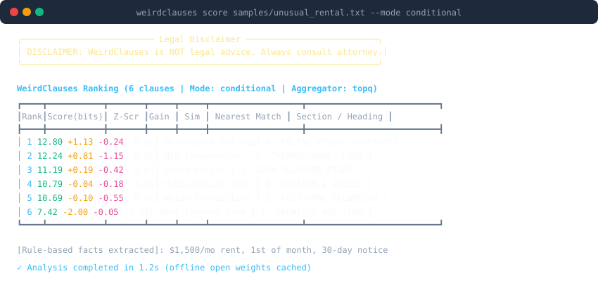
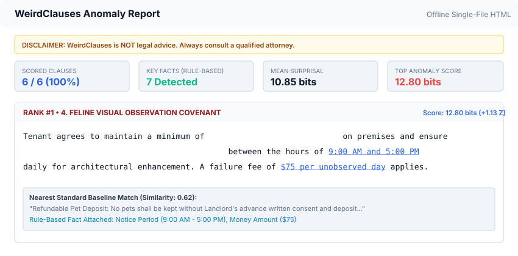
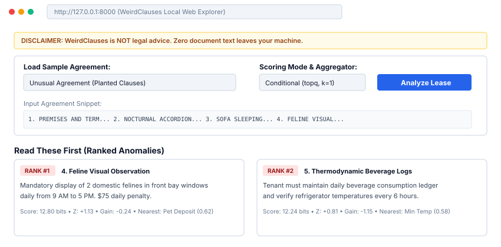
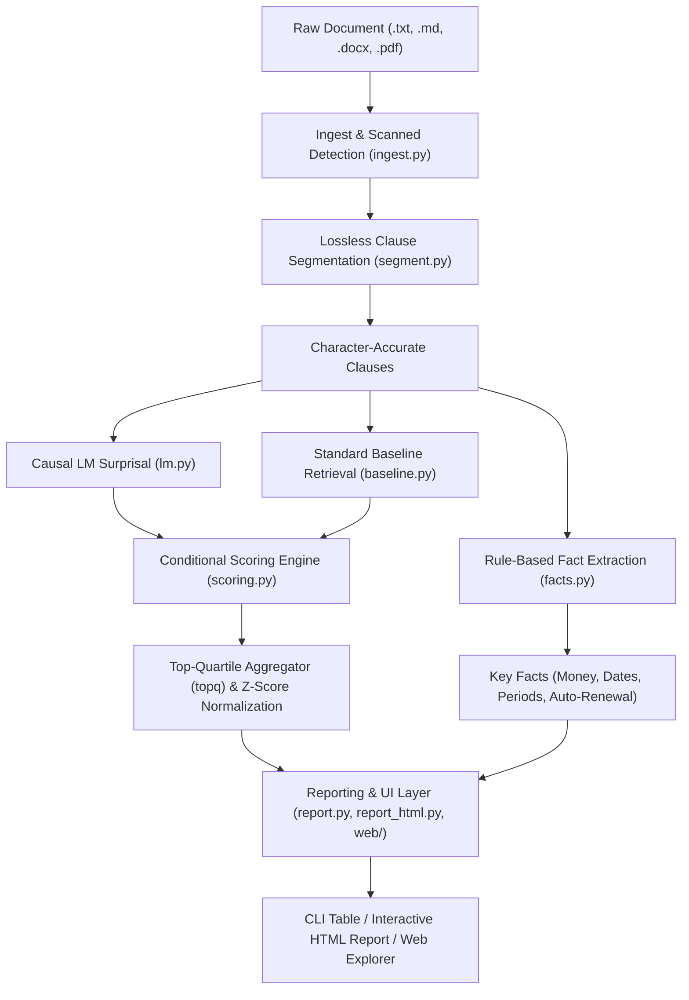

# WeirdClauses

> **DISCLAIMER: WeirdClauses is NOT legal advice.** It is an open-source research and text-analysis tool designed to highlight unusual phrasing and candidate anomalies in contracts. It does not provide legal interpretation, counsel, representation, or warranty. Always consult a qualified attorney for legal guidance.

---

**WeirdClauses** is a local, privacy-first contract anomaly exploration tool built for the DEV Hacktoberfest Open-Source AI Challenge (Theme: *"Slow and Steady"*, rewarding laziness). Instead of reading repetitive 25-page residential leases line by line, WeirdClauses losslessly segments agreements into clauses, computes **linguistic surprisal** ($-\log_2 P(\text{token} \mid \text{context})$) using an open-weight base causal language model, contrasts each clause against a semantic baseline corpus of standard terms, and ranks them by unusualness. The reader can skim the boring majority and slow down only on the weird clauses.

---

## Why Open Weights Are Central

WeirdClauses is architected from the ground up around local, open-weight models (`Qwen/Qwen2.5-0.5B` and sentence embedder `all-MiniLM-L6-v2`):

1. **Strict Document Privacy**: Legal agreements contain sensitive tenant and landlord identities, financial records, addresses, and proprietary covenants. With open weights, zero document text, tokens, or metadata ever leave your machine.
2. **100% Offline Capability**: Runs entirely on local CPU or GPU. Operates in air-gapped corporate environments, offline laptops, or flights with no internet connection.
3. **Zero API Cost & Telemetry**: No recurring per-token subscription charges, no rate limits, and no vendor lock-in.
4. **Token Log-Probabilities Requirement**: Surprisal requires teacher-forced exact per-token log-probabilities ($\log_2 P(t_i \mid t_{<i})$) from raw causal base models without generation. Hosted chat and instruction APIs (e.g., ChatGPT, Claude) either do not expose token logprobs or distort them through RLHF and instruction tuning.

---

## Visual Previews

### CLI Ranking & Anomaly Scoring


### Character-Accurate Standalone HTML Heat-Map Report


### Local Interactive Web Explorer


---

## Architecture

WeirdClauses processes documents through a multi-stage pipeline combining open-weight causal language modeling, semantic retrieval, and deterministic rule-based fact extraction:



---

## Prerequisites

- **Python**: Version `3.11` or `3.12`
- **PyTorch**: Version `2.0+`
- **Memory**: $\approx 1.5\text{ GB}$ RAM (CPU inference runs smoothly on standard laptops)
- **Disk Space**: $\approx 1\text{ GB}$ for local model weights and disk caches

---

## Quickstart (Under 10 Minutes, No Credentials Required)

Judges and reviewers can clone and evaluate WeirdClauses immediately with zero credentials.

### 1. Clone & Setup Virtual Environment
```bash
git clone https://github.com/your-username/weirdclauses.git
cd weirdclauses

python3 -m venv .venv
source .venv/bin/activate
pip install -e ".[dev]"
```

### 2. Fast Evaluation in `--mock` Mode (Zero Model Downloads)
Test the entire pipeline offline without downloading model weights using precomputed deterministic tables:

```bash
# 1. Run system diagnostics in mock mode
weirdclauses doctor --mock

# 2. Score a sample lease and display the top 5 anomalies
weirdclauses score samples/unusual_rental.txt --mock --top 5

# 3. Export an interactive standalone HTML report
weirdclauses review samples/unusual_rental.txt --mock --out report.html

# 4. Launch the local web explorer
weirdclauses serve --mock --port 8000
```

### 3. Real Open-Weight Model Mode (Local Offline Inference)
Run with the open-weight base model (`Qwen/Qwen2.5-0.5B` via Hugging Face Transformers):

```bash
# 1. Verify environment and download open-weight models (one-time)
weirdclauses doctor

# 2. Score agreement using conditional standard-baseline comparison
weirdclauses score samples/unusual_rental.txt --mode conditional --aggregator topq --top 10

# 3. Export self-contained HTML report with token heat-map
weirdclauses review samples/unusual_rental.txt --out report.html --top 10%

# 4. Open interactive web explorer
weirdclauses serve --port 8000 --open
```

---

## Public Hosted Demo (Mock Mode)

> **HONEST DISCLOSURE**: The hosted web demo serves **precomputed deterministic results on synthetic samples only** (`WC_MOCK=1`, `WC_PUBLIC_DEMO=1`). Because WeirdClauses is fundamentally built for privacy, **arbitrary document uploads are disabled in the hosted demo**, and no request bodies are ever logged. Real-world contract review is **strictly local-only** to guarantee zero data leaves your machine.

- **Hosted URL**: [https://weirdclauses-demo.onrender.com](https://weirdclauses-demo.onrender.com)
- **Health Check Endpoint**: `GET /health` returns service status and legal disclaimer.

### Deploying Your Own Demo to Render

You can deploy your own instance of the public mock demo on [Render.com](https://render.com) using the included [`render.yaml`](render.yaml) blueprint:

#### Exact Render Dashboard Steps:
1. **Fork or Push** this repository to your GitHub or GitLab account.
2. Sign in to the **[Render Dashboard](https://dashboard.render.com)**.
3. Click the **New +** button in the upper-right corner and select **Blueprint**.
4. Connect your repository (`weirdclauses`).
5. Render reads `render.yaml` and automatically configures:
   - **Service Name**: `weirdclauses-demo`
   - **Runtime**: `Docker` (using the slim `Dockerfile` without PyTorch)
   - **Plan**: `Free`
   - **Health Check Path**: `/health`
   - **Environment Variables**: `WC_MOCK=1`, `WC_PUBLIC_DEMO=1`, `PORT=8000`
6. Click **Apply**.
7. Render builds the lightweight Docker image (~150 MB) and provisions your public web service.

---

## Configuration

WeirdClauses is configured via environment variables (or a local `.env` file). The settings match `.env.example`:

| Environment Variable | Default Value | Description |
| :--- | :--- | :--- |
| `WC_LM_MODEL` | `Qwen/Qwen2.5-0.5B` | Open-weight causal LM checkpoint from Hugging Face |
| `WC_EMBED_MODEL` | `sentence-transformers/all-MiniLM-L6-v2` | Sentence embedding model for baseline clause retrieval |
| `WC_CACHE_DIR` | `~/.cache/weirdclauses` | Local disk cache directory for token surprisals and embeddings |
| `WC_DEVICE` | `cpu` | Compute device (`cpu`, `cuda`, or `mps`) |
| `WC_BASELINE_DIR`| `./baseline_packs/rental` | Directory containing baseline standard clause packs |
| `WC_MOCK` | `0` | Set to `1` to force fast deterministic mock mode with zero downloads |
| `WC_PUBLIC_DEMO` | `0` | Set to `1` to enforce character limit (50k chars) for public hosted demos |

### Alternative Models (e.g. Gemma)
A Gemma-family base model works through the identical code path:
```bash
# Accept the Gemma license at https://huggingface.co/google/gemma-2-2b
export HF_TOKEN="your_huggingface_token"
export WC_LM_MODEL="google/gemma-2-2b"
weirdclauses doctor
```

---

## Evaluation Benchmark

WeirdClauses includes a benchmark evaluating rankers across 100 synthetic residential leases (1,516 total clauses, 292 planted unusual clauses) sampled from a held-out standard pool to prevent data leakage. Confidence intervals (95%) are computed via 1,000 bootstrap resamples:

```bash
make eval
```

### Benchmark Summary

| Ranker | Recall@10% [95% CI] | Mean Percentile Rank [95% CI] | MRR [95% CI] |
| :--- | :---: | :---: | :---: |
| **Random** | 0.150 [0.113, 0.189] | 0.513 [0.476, 0.547] | 0.422 [0.365, 0.484] |
| **Longest Clause** | 0.722 [0.683, 0.762] | 0.923 [0.916, 0.931] | 1.000 [1.000, 1.000] |
| **TF-IDF Distance** | 0.273 [0.222, 0.321] | 0.775 [0.758, 0.793] | 0.575 [0.517, 0.638] |
| **Keyword/Rule Heuristic** | 0.564 [0.523, 0.607] | 0.803 [0.777, 0.830] | 0.948 [0.915, 0.975] |
| **Raw Surprisal (mean)** | 0.222 [0.185, 0.264] | 0.648 [0.621, 0.678] | 0.585 [0.513, 0.651] |
| **Raw Surprisal (topq)** | 0.270 [0.228, 0.317] | 0.687 [0.658, 0.714] | 0.650 [0.583, 0.716] |
| **Raw Surprisal (max)** | 0.300 [0.261, 0.343] | 0.682 [0.655, 0.708] | 0.622 [0.564, 0.683] |
| **Conditional Surprisal (mean, k=1)** | 0.420 [0.372, 0.472] | 0.806 [0.787, 0.824] | 0.793 [0.740, 0.845] |
| **Conditional Surprisal (topq, k=1)** | **0.517 [0.469, 0.563]** | **0.820 [0.799, 0.842]** | **0.916 [0.871, 0.958]** |
| **Conditional Surprisal (topq, k=3)** | 0.482 [0.434, 0.530] | 0.793 [0.770, 0.815] | 0.893 [0.843, 0.942] |

Full benchmark artifacts:
- [`eval/results/benchmark_table.md`](eval/results/benchmark_table.md)
- [`eval/results/benchmark_summary.json`](eval/results/benchmark_summary.json)
- [`eval/results/benchmark_chart.svg`](eval/results/benchmark_chart.svg)

---

## How to Add Your Own Baseline Pack

WeirdClauses supports custom standard baseline packs (e.g., for commercial leases, employment agreements, or specific state/municipal codes):

1. **Create a Pack Directory**:
   ```bash
   mkdir -p baseline_packs/commercial
   ```
2. **Draft Standard Clauses**:
   Add Markdown files (one clause per file) with YAML front matter:
   ```markdown
   ---
   topic: rent_commencement
   title: Commercial Rent Commencement Date
   jurisdiction: us-commercial-synthetic
   synthetic: true
   ---
   Base rent shall commence on the date Tenant opens for business or ninety days following substantial completion...
   ```
3. **Configure the Pack**:
   ```bash
   export WC_BASELINE_DIR="./baseline_packs/commercial"
   weirdclauses score my_lease.txt --mode conditional
   ```
   WeirdClauses will automatically generate and cache sentence embeddings for your pack in `WC_CACHE_DIR`.

---

## Documentation & Limitations

- **Methodological Limitations**: Read [`docs/LIMITATIONS.md`](docs/LIMITATIONS.md) for detailed analysis on synthetic benchmark optimism, linguistic surprisal vs. substantive unfairness, and regional jurisdiction boundaries.
- **Real-Contract Case Study Protocol**: Read [`docs/CASE_STUDY.md`](docs/CASE_STUDY.md) for a step-by-step protocol to evaluate WeirdClauses on real agreements you have permission to test, tracking full read time vs. triaged read time.
- **Demo Recording Guide**: Read [`scripts/record_demo.md`](scripts/record_demo.md) for instructions and automated VHS scripts to record a 60–90 second demo GIF.

---

## Contributing

Contributions are welcome! Please read [`CONTRIBUTING.md`](CONTRIBUTING.md) for our coding guidelines (Ruff, typing, module size $\le 250$ lines, synthetic data only, and privacy principles).

---

## License

This project is licensed under the [MIT License](LICENSE).
